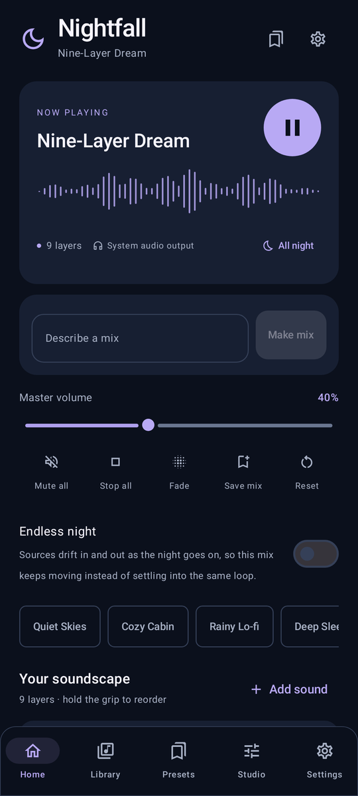
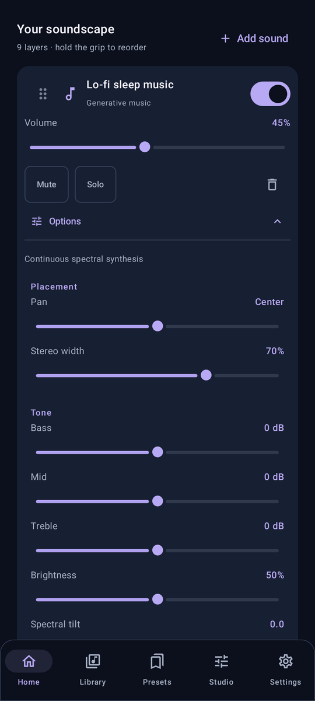
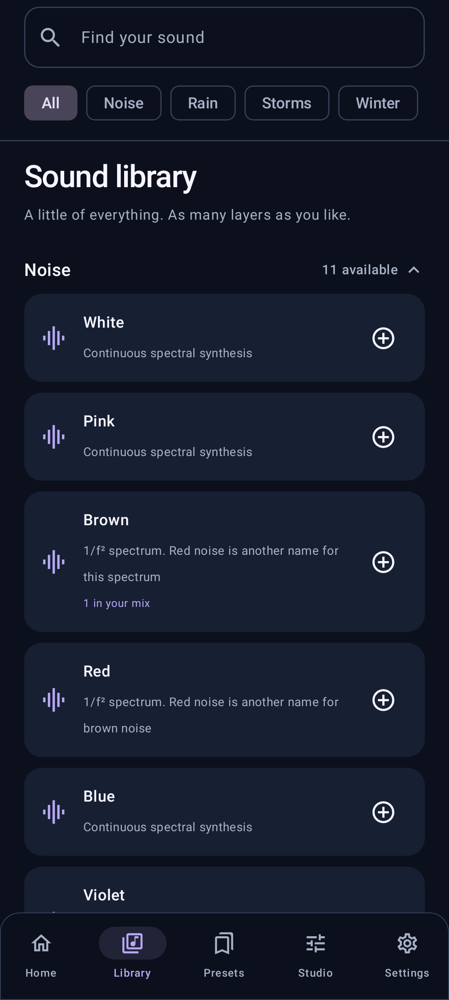
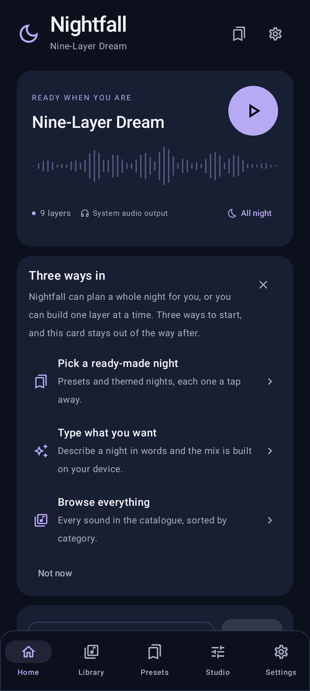

# Nightfall

**A free Android sleep sound mixer that never needs the internet.** No account,
no analytics service, no advertising, no microphone, no subscription — and nothing
to sign into before it will play a fan noise. Sounds are layered and mixed on the device
through one 48 kHz stereo path, so ten layers of rain, wind, fire and music arrive
as a single night rather than ten loops fighting each other. Everything you hear is
generated or played locally; the one build that can reach the network uses it for
its own updates and nothing else.

Android 8.0+ (API 26) · Kotlin and Compose · MIT

| Home, playing | One layer's options | The sound library | First run |
| --- | --- | --- | --- |
| [](fastlane/metadata/android/en-US/images/phoneScreenshots/01-home-playing.png) | [](fastlane/metadata/android/en-US/images/phoneScreenshots/03-layer-options.png) | [](fastlane/metadata/android/en-US/images/phoneScreenshots/04-library.png) | [](docs/site/shots/07-first-run-card.png) |

Those are screens rendered from the app's own Compose tree on a JVM: `MainActivity`'s window,
drawn by Robolectric's native graphics, with each screen reached through the app's own
navigation. No phone and no emulator are in that path, and there is no device frame in the
pictures — no status bar, no gesture bar, no animation. The full-size 1078×2399 PNGs of the
first three are in
[`fastlane/metadata/android/en-US/images/phoneScreenshots`](fastlane/metadata/android/en-US/images/phoneScreenshots);
the first-run card is kept at the size shown. [`docs/TESTING.md`](docs/TESTING.md) records how
they are generated and what they cannot show.

## Nightfall 2.0

2.0 is not a rewrite. It is the release where the app became small, configurable and
current:

- **11.7 MB instead of 79.5.** The seven bundled recordings ship as 10,089,142 bytes of
  Opus rather than 77,449,472 bytes of raw PCM, in both channels. The `arm64-v8a` APK is
  11,737,776 bytes against 79,465,722 for the same file on 1.11, the last release that
  carried PCM.
- **Endless night.** A switch on Home lets the mix evolve over hours instead of looping one
  fixed bed: companion layers drawn from the same families as your own arrive and leave, and
  every layer's tone drifts around its setting. Measured on eight-hour renders of one preset
  with the night on and off, the worst hour against hour moves the level by 0.22 LU.
- **Themed nights.** Four presets are a plan over the night rather than a snapshot of layers:
  *Storm That Passes* opens on heavy rain, thunder and howling wind for two hours, moves to rain
  on a metal roof with rolling thunder, then drizzle, then a distant ocean bed. *Rain That Calms*,
  *Forest Dusk* and *Fire That Burns Down* do the same in their own families. Each phase takes
  over across three minutes, and the night keeps the loudness you set: over eight hours the whole
  night lands within 0.01 dB of the same mix with its plan switched off. Every phase is also its own
  texture — the closest pair inside a theme is 0.6 dB apart by band profile. Nobody has listened to
  one yet, so that is a measurement and not a verdict.
- **A home-screen play/pause widget** that drives the app's own media session, so its state
  follows what is playing rather than the last tap, and **a Quick Settings tile** offering the
  same control one swipe away, without unlocking the phone.
- **Hidden, opt-in diagnostics** — five taps on the Settings version row. Off until you turn
  it on: a bounded local journal (200 entries, 64 KB or 30 days, closed-set tokens and no
  free text), a Share action you start yourself, and no transport in either channel.
- **Android 16.** `targetSdk` 36, with a CI job that runs the app's own suite on an API 36
  runtime, so the behaviour a 36 target turns on is executed rather than read.
- **Every UI string in resources**, with a build-time guard that fails the build on the next
  literal typed into a Compose call.

Those are the wins. The limits belong in the same breath: **the Opus decoder has never run on
a device** — 1.12 was the first build to depend on it, and if a platform refuses Opus the app
says so at start-up instead of playing silence; **no ear has heard the current catalogue on a
phone**; **the widget has never been seen on a launcher**; and **diagnostics has never
recorded a real crash.** Each of those four is repeated in *Never checked on hardware* below,
and none of this section is a claim about how any of it sounds.

## What it does

**Build a night out of 106 sounds.** Eleven noise colours, rain, storms, winter,
wind, water, fire, indoor hum, travel, seven bundled field recordings and eighteen
generated music profiles. One row — *Distant household ambience* — is declared and
**disabled** rather than filled with substitute audio, because no recording we may
redistribute exists for it. That is a deliberate absence, not a bug. Twenty-one built-in
mixes start you off, and every one of them is an ordinary mix you can edit, rename or
duplicate.

**Every layer is its own instrument.** Volume, on/mute/solo, stereo position and
width, high- and low-pass, three-band EQ, brightness, its own stop time, and — for a
storm — a chosen number of minutes after which it becomes rain while the fireplace
keeps going. Duplicate layers keep independent random streams, so two brown-noise
layers are not one layer twice as loud.

**No layer cap.** Nine is the name of a preset, not a limit — the app opens on
*Nine-Layer Dream*, nine independent layers already loaded. Add layers until the
phone runs out of headroom; Home warns at 65% of the render budget or above three
underruns instead of quietly glitching or enforcing an arbitrary count.

**Recordings that do not announce themselves.** Every bundled loop plays for at
least three minutes before it repeats — the cycles are 180.5 to 240 seconds, with a
one-second overlap so the seam is not a click. Thirty-second loops are what the brain
latches onto at 2 a.m.

**A timer that ends the night, not the track.** 5, 10, 15, 30, 45, 60, 90 or 120
minutes, *All night*, any custom 1–1440, or a time of day: "until 6:30", with 6:30, 7:00
and 8:00 one tap away at any hour and a picker for anything else. It fades out gently
instead of cutting, pauses when you pause and resumes without drifting, and each layer
can hold its own stop schedule.

A timer set by the clock is still a countdown. It runs the minutes between now and the
time you chose, then fades on the same path every duration uses, so pausing, the fade and
a restart behave identically. Change the phone's clock mid-night — a daylight-saving
change, a manual correction — and the night ends the same number of minutes after it
started, which may not be the wall time on the label. That is what a countdown can
honestly promise; a timer that re-reads the clock is an alarm, and this app has none.

**Screen off, phone on the nightstand.** A Media3 foreground media session gives you
lock-screen and Bluetooth controls, pauses when the headphones disconnect, and holds
a wake lock only while it is playing. Playback is not tied to the screen or the
activity, and nothing wakes the radio.

**Your mixes stay yours.** Saved locally in DataStore, with presets, favourites,
duplication, rename, delete, and JSON export and import through Android's own file
picker. No sync, no server, no export you did not ask for.

**Labels that mean something.** Synthesis says "Locally synthesized"; recordings say
"Bundled field recording" with a credit link in Settings. Gray, green and black noise
are called shaping presets rather than pretend standard noise colours. Binaural tones
state their actual frequency difference, the stereo requirement, and that sleep-stage
or healing benefits are not established. A4=432 Hz is labelled as musical tuning, not
therapy.

**The interface is also in Spanish — machine-drafted, and not yet read by a native speaker.**
Every string has a Spanish counterpart, kept complete by a parity check in CI, but the
translation was machine-drafted: a native speaker has not reviewed it, and corrections
through a pull request are welcome. The sound names and preset titles stay in English in
both locales — they are catalogue data stored in saved mixes and exports, so translating
them would change what a saved mix means.

## Screenshots

The six PNGs in `fastlane/metadata/android/en-US/images/phoneScreenshots/` are the
shipped Compose UI, rendered on a JVM: `MainActivity`'s own window, drawn by
Robolectric's native graphics with the app driven through its own navigation. That is
the only route available here, because these build machines have no `/dev/kvm` for an
emulator. Nothing is a mockup and nothing was composited by hand. They show no status
bar and no animation, and the render-load figures in Settings are the harness's rather
than a phone's; `docs/TESTING.md` records how they are generated, how to regenerate
them, and what they cannot show.

## Hear it

Sound is the whole product, and installing an 11.7 MB APK to find out what it sounds like is a lot to
ask. These are short clips of the engine output, one per sound or mix, 20 to 30 seconds each:

- [**Nine-Layer Dream**](docs/samples/nine-layer-dream.ogg) — the app's opening preset: lo-fi music,
  brown noise, rain, a blizzard, hail, rolling thunder, wind, fire and a 440 Hz tone, layered at once.
- [**Storm That Passes**](docs/samples/storm-that-passes.ogg) — a themed night from second zero, where
  the storm is at its loudest and three more phases are still ahead.
- [**Heavy rain on a metal roof, with a fire**](docs/samples/heavy-rain-metal-roof-fire.ogg) — the
  phrase box building a three-layer mix out of a sentence.
- [**Rain on tent**](docs/samples/rain-on-tent.ogg) — one synthesized rain, alone.
- [**Ocean waves**](docs/samples/ocean-waves.ogg) — the surf generator: a slow swell, a long low wash
  and a little spray.
- [**Campfires**](docs/samples/campfires.ogg) — a fire whose crackles are generated at a settable rate
  rather than looped.
- [**Brown noise**](docs/samples/brown-noise.ogg) — 1/f² noise, the plainest thing the app makes.
- [**Lo-fi sleep music**](docs/samples/lo-fi-sleep-music.ogg) — the lo-fi music profile, generated at
  42 BPM.

These were rendered offline by the same synthesis code the app runs, at its own 48 kHz stereo rate
and block size, with the bundled recordings it ships, and then encoded to Opus. They are not
recordings of a phone: no device went near them, Android's own audio path and decoder are not in the
chain, and no speaker or headphone was involved. So they prove what the engine computes and say
nothing about how it will sound on your pillow speaker or through your particular earbuds — and
nobody here has listened to them with an ear. [What each clip is set
to](docs/samples/README.md), the byte sizes, and the one command that regenerates the set are in
`docs/samples/`.

## Install

### GitHub Releases — the channel that works today

1. Open **[Releases](https://github.com/CamjamPNG/Nightfall/releases)** and take the
   newest version. The current one is **2.0**.
2. Pick **`arm64-v8a`** for a modern phone (a Pixel 7, most Android phones from the
   last five years), or **`universal`** if you are unsure. `armeabi-v7a`, `x86` and
   `x86_64` cover older 32-bit devices and Intel emulators, and
   **`fdroid-universal`** is the offline build described below. All of them contain the
   complete offline library; the five `github` files differ only in which native
   libraries are inside.
3. Open the APK on the phone and allow installs from your file manager when Android
   asks.

The seven field recordings ship as Opus containers, 10,089,142 bytes for the set
against 77,449,472 bytes as raw PCM. The `arm64-v8a` APK is **11,737,776 bytes (11.2 MiB)**
in 1.13's release assets, `universal` 11,836,600 bytes and `fdroid-universal`
11,754,680 bytes; 2.0 adds no code, so it publishes at the same size. The same
`arm64-v8a` file was 79,465,722 bytes (75.8 MiB) in 1.11, the last release that carried
PCM. The recordings are still most of the download — 10,089,142 bytes of 11,737,776 — but
the number they are most of is now 14.7% of what it was. R8 minification and resource
shrinking, which landed in 1.5.2, are what keep the rest small: 3,041,456 bytes of dex,
read out of that APK's `classes.dex` and unchanged in a local release build of this
commit.

**What that switch costs in certainty, stated plainly:** the containers are verified by a
test that decodes every one of the seven with an independent, conformant Opus decoder,
so the container layout, packet framing and payload are real Opus and not just bytes our
own loader agrees with. Nothing has decoded them through Android's own decoder on a
phone: that binding is untested. If a phone refuses Opus, the app says so when it starts
rather than playing silence, and every earlier release stays published and installable.

This channel can update itself afterwards, and by default it does: **Update automatically**
is on, so a newer release is downloaded, verified and installed without a tap. Settings
shows the installed version and that switch, and **Check for updates** stays a check you
started. What the app will not do is interrupt a night already playing — an install
restarts it, so a downloaded update waits, says so in a row over the app, and installs
when sound is stopped or on the next launch. Turn the switch off and nothing downloads
until you press **Update**.

On its own it asks GitHub never sooner than fifteen minutes after any previous attempt,
and never more often than once every six hours counted from the last successful answer —
with no successful answer yet, the fifteen-minute floor is the only limit. A check you
start obeys the same fifteen-minute floor. The APK it accepts must match the manifest's
size, SHA-256, package id, version code and the certificate of the app already installed.
No background worker, alarm or periodic wake-up exists, so an app that is not in the
foreground never checks anything. Both pacing rules are in `CheckThrottle.kt`, and the
playback guard is `UpdateAutomation.mayInstallNow` in `UpdateAutomation.kt` — those are
the places to read before paraphrasing them.

**What's new** in Settings → Updates lists the recent releases with their notes, from the
copy the app already holds, so reading it asks the network for nothing. The notes come
from the release manifest, which `tools/package_release.py` generates from this
repository's own changelog. After the app replaces itself, the version it installed shows
those notes once. Details in [`docs/RELEASING.md`](docs/RELEASING.md) and
[`PRIVACY.md`](PRIVACY.md).

### The F-Droid build — downloadable, and buildable from source

The second channel is the same app with the updater removed, not the same app
configured not to use it. It has no manifest parser, no fetcher, no installer and no
network code, and it declares none of the four network or install permissions.

Every release carries it as `Nightfall-<version>-fdroid-universal.apk` — one universal
APK, signed with the same pinned key and published beside the update options. It is
deliberately kept out of `release-manifest.json`, so the in-app updater never offers a
build that cannot update itself, and updates arrive by installing the next release's
copy yourself. It also builds from source:

```sh
./gradlew :app:assembleFdroidDebug
# app/build/outputs/apk/fdroid/debug/app-fdroid-debug.apk
```

CI builds this channel, lints it, and runs the same twelve playback-lifecycle scenarios
the widget's twenty and the tile's six against it on every push; `tools/check_release.py --fdroid-apk`
asserts from the built dex and manifest that no updater class and no network permission
survived.

### The self-hosted F-Droid repository — address reserved, not serving yet

Nightfall intends to be installable through the official F-Droid client from an index
it builds and signs itself:

```
https://camjampng.github.io/Nightfall/fdroid/repo
```

**That address returns 404 today, measured on 18 November 2026**, so please use the
Releases page instead. The index builder, its refusal paths and its fingerprint
invariant exist and were exercised locally against published APKs, but the one-time
setup has not been run: `fdroid/repo/fingerprint.txt` is empty, the repository key is
not installed, and GitHub Pages is not enabled for this repository. When it does go
live it will serve only the offline build — the builder refuses any APK that declares
`INTERNET` or `ACCESS_NETWORK_STATE`, and refuses anything not signed with the pinned
release certificate. It will *not* be F-Droid-verified: adding it means trusting the
maintainer's repository key, and F-Droid has checked nothing about it. The full state,
failure modes and key handling are in [`docs/FDROID.md`](docs/FDROID.md).

### F-Droid's main repository — not submitted, and not before February 2027

The build recipe, store metadata, changelogs and category are complete in `fdroid/`,
and they validate: `fdroid readmeta`, `rewritemeta`, `lint` and `scanner` are clean, and
the recipe selects the offline flavour at every tag. The blocker is not metadata, it is
eligibility. F-Droid's Inclusion Policy asks that an application "should have been
actively developed for at least 3 months", and Nightfall's first public release was
12 November 2026, so the earliest ordinary submission is **around 12 February 2027**. No
merge request exists. Nothing here claims F-Droid has accepted, reviewed or blessed
anything.

### An older development build

The first development APK used the package `dev.nightfall` and can stay installed
beside the release. Export your mixes as JSON, install the release, import them, then
remove the old package — uninstalling deletes its private data.

### Which build is which

The two channels differ in exactly one thing — the update check — and it is the only
difference the copy anywhere in this project is allowed to blur.

| | `github` (every APK on Releases) | `fdroid` (one `fdroid-universal` APK on Releases, buildable from source) |
| --- | --- | --- |
| Playback, generation, presets, timers, storage | identical | identical |
| Works fully offline, radio off | yes | yes |
| Declares `INTERNET`, `ACCESS_NETWORK_STATE` | yes | **no** |
| Declares `REQUEST_INSTALL_PACKAGES`, `UPDATE_PACKAGES_WITHOUT_USER_ACTION` | yes | **no** |
| Updater code in the APK | yes | **none** — no parser, fetcher or installer |
| Talks to the network | only to read one public release manifest and download one APK, on a check you start or the app's own | never |
| Settings → Updates | installed version, **Update automatically**, **Check for updates**, **What's new** | installed version and where updates come from |

So "Nightfall has no `INTERNET` permission" is true of the F-Droid channel and false of
every file on the Releases page. There is also no switch that turns the check off in
the current release: its own check runs never sooner than fifteen minutes after any
previous attempt and never more often than once every six hours counted from the last
successful answer — with no successful answer yet, the fifteen-minute floor is the only
bound — and a check you start obeys the fifteen-minute floor and nothing else. Pacing
lives in `CheckThrottle.kt` and the update states that can hold a check back live in
`GithubUpdater.kt`; this page deliberately does not retell either. Dismissing an update
row hides that notice, and does not stop the next check. If a build that cannot open a
socket at all is the point for you, that build is the `fdroid` one — which today means
building it yourself.

Both channels declare what a background music player needs and nothing more:
foreground service, the media-playback foreground type, notifications, and a wake
lock. Neither declares microphone, storage, location, contacts or account permissions,
and the permission set of each built APK is asserted in CI rather than described here.

## What is proven, and what nobody has checked

This project's differentiator is not a feature list; plenty of apps have rain. It is
that the claims are separated into what a test asserts, what a script measures, and
what no one has ever confirmed. All three columns are kept honest in
[`docs/TESTING.md`](docs/TESTING.md).

### Asserted by a test in this repository

| Claim | Test |
| --- | --- |
| Nine simultaneous sources stay non-silent and independently audible, and 512 layers allocate without falling over | `MixerTest.nineSourcesAreSimultaneousAndIndependentlyAudible`, `…stopResetsSessionAndThereIsNoNineLayerCap` |
| Output stays under the soft limiter's ceiling — no sample above 0.53, 4× oversampled true peaks below −1.0 dBTP | `RenderPathTest.outputNeverLeavesTheLimiterCeiling`, `LoudnessTargetTest.maximumSettingsRespectTheTruePeakCeiling` |
| The render path allocates nothing after warm-up | `RenderPathTest.renderAllocatesNothingAfterWarmup` |
| Adding or removing a layer is no louder a step than the material itself, and does not disturb another layer's phase or random stream | `RenderPathTest.addingAndRemovingALayerIsAsSmoothAsTheMaterial`, `MixerTest.dynamicAdditionRemovalPreservesOtherSourcePhase`, `…duplicateNoiseLayersHaveIndependentRandomStreams` |
| Noise colours have their stated spectral slope, output has no DC offset, and music voices are in tune to the cent | `RenderPathTest.noiseColoursHaveTheirStatedSpectralSlope`, `…outputHasNoDcOffset`, `…musicVoicesAreInTuneToTheCent` |
| No bundled recording loops before three minutes, and every one loops without a seam | `AudioAcceptanceTest.noBundledRecordingLoopsBeforeThreeMinutes`, `RenderPathTest.everyFieldRecordingLoopsWithoutASeam` |
| Every playable catalogue row renders finite, nonzero output | `AudioAcceptanceTest.entireAvailableCatalogHasRealAudibleOutput` |
| Every catalogue source is trimmed to −18 LUFS at full layer gain, so a percentage means the same loudness for every sound | `Levels.REFERENCE_LUFS`, `LoudnessTargetTest.everyContinuousSourceReachesTheReferenceLevel` |
| The updater refuses a foreign package id, a foreign signing certificate, a downgrade, a mismatched checksum, an address outside this repository's assets, and a truncated or oversized response | `UpdatePolicyTest`, `ReleaseManifestParserTest`, `ReleaseFetchTest` (the `update` package counted below) |
| An install the app starts itself never lands in playing audio — refused while playing, refused on an unknown playback fact, allowed only when stopped, and a night that starts in playback ends with exactly one install, at the stop | `UpdateAutomationTest` |
| Playback that resumes while the APK is being copied never reaches the installer commit; the session is abandoned and the update goes back to waiting | `InstallWindowTest` |
| Release notes survive a hostile or missing `log` in the manifest without changing a single trust field | `ReleaseManifestParserTest.hostileNotesNeverChangeTheTrustDecision`, `…aManifestWithNoNotesStillUpdates` |
| Playback survives navigation, activity recreation, backgrounding, audio-focus loss, a back gesture and service teardown | `BackGestureTest`, `BackgroundPlaybackTest`, `AudioFocusTest`, `StateRestorationTest`, `TeardownTest`, run under both channels in CI |
| The home-screen widget starts, pauses and resumes the loaded mix through the app's own media session, and its state follows the session rather than the last tap | `WidgetStoppedToPlayTest`, `WidgetPlayingToPauseTest`, `WidgetPausedToPlayTest`, `WidgetFollowsSessionTest` |
| The widget's button is inside its own surface and its label is not cut, at one cell and at two, in both themes | `WidgetLayoutTest`, `WidgetRenderTest` (PNGs in `build/screenshots/github`) |
| The Quick Settings tile starts, pauses and resumes the loaded mix through the app's own media session, reads stopped until something has played, and its state follows the session rather than the last tap | `TileStoppedToPlayTest`, `TilePlayingToPauseTest`, `TilePausedToPlayTest`, `TileFollowsSessionTest`, `QuickTileStateTest` |
| The F-Droid APK carries no network permission and no class from the updater package, and the GitHub APK carries code from every updater source file | `tools/check_release.py --fdroid-apk` and `--apk`, on every push |

How many tests: this generated table is where these numbers live, and `docs/LAUNCH.md` carries the
same generated block, so a count in either is the tree's count. `tools/count_tests.py` generates
it from the tree and `tools/check_release.py` fails the push that disagrees with the code, so no
document has to be trusted for a count. A `@Test` method is one test; **Runs by default** leaves
out `@Ignore`d tests and the tests whose first statement skips them — `LevelCalibrationTest`'s
generator waits for `NIGHTFALL_CALIBRATE=1` and is the only one, which is why `core` reads as 127
declared and 126 run rather than one number that means both. `Robolectric` and `Plain JVM` are what
the file's runner annotation says, not a guess. Everything in `app/src/test` executes twice in
CI's `unit` job, once per channel; `app/src/testGithub` exists only in the `github` channel and
executes once. All of it runs on a JVM with no device, no emulator and no network.

<!-- test-counts:begin (generated by `python3 tools/count_tests.py --update`; do not edit by hand) -->
| Suite | Tests | Runs by default | Opt-in | Ignored | Robolectric | Plain JVM | `unittest` |
| --- | --- | --- | --- | --- | --- | --- | --- |
| `app/src/test` | 100 | 100 | 0 | 0 | 94 | 6 | 0 |
| `app/src/testGithub` | 93 | 93 | 0 | 0 | 24 | 69 | 0 |
| `core/src/test` | 127 | 126 | 1 | 0 | 0 | 127 | 0 |
| `tools/tests` | 120 | 120 | 0 | 0 | 0 | 0 | 120 |
| **Total** | 440 | 439 | 1 | 0 | 118 | 202 | 120 |
<!-- test-counts:end -->

`python3 tools/count_tests.py` prints that table, `--files` adds a row per file so a count can be
traced to the file that declares it, and `--update README.md` rewrites the block above.

### Measured by a script or recorded in the repository

| Claim | Evidence |
| --- | --- |
| The GitHub APK declares all four network and install permissions; the F-Droid one declares none | `tools/check_release.py` on the built APKs, wired into CI |
| Release APKs are aligned and signed by the pinned certificate, and the manifest's download addresses point only at this repository's release assets | `tools/package_release.py`, `tools/verify_release.py` |
| Two machines building the same tag produce byte-identical APKs | `docs/verification/reproducibility.json` and `docs/FDROID.md` |
| The F-Droid recipe parses, rewrites to canonical form, lints clean, and its source scanner reports no errors | `docs/verification/fdroid-source-scan.json`, `fdroid-apk-scan.log` |
| No GMS, Firebase, billing, advertising or tracking SDK is in the resolved dependency graph | `docs/verification/dependency-audit.json` |
| The APK sizes above, and the 10,089,142 bytes of Opus containers | `ls -l` and `unzip -l` of the unsigned universal release and debug builds; `app/src/opus/assets/audio`; `OpusAssetDecodeTest` decodes every container with Concentus |
| Every control on Home, Library, Presets and Settings has a name, a state and a hit area a screen reader can use | `AccessibilitySemanticsTest` walks the semantics tree Compose builds — the transport's state, a layer's muted and soloed state, a slider's value and its set-without-dragging action, a reorder's custom actions, the phrase box's chip that removes itself, and the touch bounds of every control on four surfaces. `docs/ACCESSIBILITY.md` records what each one said before |
| Body text and control boundaries clear 4.5:1 and 3:1 in both themes | `ContrastTest` computes each ratio from the palette the theme is built from, and fails a pair that clears its threshold by less than 0.4. The worst body pair is 5.34:1 (day secondary text on a day card); the night slider groove was 1.40:1 and is 3.60:1 |
| Text at 200% stays inside the window on Home, Settings and the first-run card | `FontScaleTest` hosts the real `NightfallScreen`, `SettingsScreen` and `FirstRunCard` at a doubled font scale and asserts no control crosses the window edge and that the controls with text are minimums rather than fixed boxes |

### Never checked on hardware

| Gap | What is missing |
| --- | --- |
| That it sounds good, or that nine layers sound right | No listening test and no acoustic measurement exists — no ear has heard the current catalogue on a phone; loudness is digital gain, not a sound-pressure claim |
| That the bundled recordings decode and play on a phone | The containers are verified against a conformant pure-Java Opus decoder in the test suite, which proves the format and says nothing about Android's `MediaCodec` binding to it. No device has decoded one, so the actual sound of all seven is unverified. A platform that refuses Opus is reported when the app starts instead of playing silence |
| A screen reader on a phone | No TalkBack session, no accessibility scanner pass and no real finger has touched any of this. The tests read the semantics tree Compose builds, which is a contract about what is offered — not a measurement of whether a sentence is comprehensible in a dark room. Whether the two polite live regions are actually spoken, whether a doubled font clips a glyph rather than a box, and whether the custom actions appear in TalkBack's actions menu in the order expected are all unverified |
| Whether a platform decoder wants initialization data beyond the identification header | The identification header is supplied as `csd-0` when the decoder accepts it and omitted when it does not, so both platform behaviours are handled by construction; no device has exercised either path. The containers carry no OpusTags or codec-delay bytes, because the encoder never produced them, and whether any decoder needs those to emit audio rather than only for gapless metadata is not established. A decoder that accepts a packet and yields nothing ends that read head with a visible "cannot be decoded" message instead of waiting forever |
| Bluetooth sleep masks and headphones, disconnect and reconnect, media buttons | Never exercised on a real device |
| The home-screen widget on a real launcher | Its twenty Robolectric scenarios drive the real media session and the widget's own views on a JVM, and two render tests draw it in both themes. No launcher has hosted it: placing it, resizing it, how a themed or third-party launcher draws its label and what it looks like at another density are unverified |
| The Quick Settings tile in a real shade | Its six Robolectric scenarios drive the real media session and the tile's own label, subtitle and glyph on a JVM. No shade has hosted it: adding it from the editor, where the system sorts it, how a themed or third-party shade draws the tile and its subtitle, the pre-Android-10 tile that has no subtitle at all, and how it looks expanded are all unverified |
| Diagnostics recording a real crash | Every entry kind is driven by tests, against exit history those tests supply. No phone has crashed under it, so a real crash, a real ANR and a real OEM kill have never been journaled, and nothing here can kill the app on a device to produce one |
| An all-night run with the screen off — underruns, battery, OEM task killers | No overnight result exists for any phone |
| The in-app update actually installing from a published release, unattended or not | `PackageInstaller` sessions and the Android 12+ prompt-free path are described from Android's documentation; the tests drive a local server speaking the same protocol. No install, no automatic restart and no post-install "What's new" has been observed on a phone. Also unverified: the waiting row and the release-log dialog rendered on a screen, the install a play-to-pause transition triggers, the commit-time deferral against Android's real installer, captive portals, proxies, and how each OEM prompts |
| A Spanish-speaking user reading the interface | Every translatable string has a Spanish counterpart and `tools/check_localization.py` keeps it that way, key by key and placeholder by placeholder. Nothing else is measured: the translation is machine-drafted, no native speaker has read it, and whether a term is ordinary Spanish or a regional or technical one is unconfirmed — the privacy, tuning and capacity paragraphs being where a wrong word would matter most. The catalogue and preset titles are English in both locales by design |
| An F-Droid client adding the self-hosted repository and auto-updating | No deployment has served a request |
| Reproducible builds on F-Droid's own buildserver | Two of our machines agree; theirs has never built it |

If one of those gaps matters to you, an issue with a device name and a logcat excerpt
is the most useful thing anyone can send right now — it is roadmap item 1, and it is
first because it is what turns every sentence above into something measured.

## Build and check it

Needs JDK 17 and Android SDK 35 with build-tools 35.0.0. These three commands are the
documented gate, and CI runs these three plus the rest of the list below.

```sh
./gradlew :core:test :app:assembleDebug :app:lintDebug   # the core suite and the debug APK; lint aborts on error
python3 -m unittest discover -s tools/tests              # the release tooling's own tests
python3 tools/check_release.py                           # store metadata, bundled audio, both channels, the counts above
```

The full CI job also runs the Robolectric suites per channel
(`:app:testGithubDebugUnitTest :app:testFdroidDebugUnitTest`) and both release builds
— see [`.github/workflows/android.yml`](.github/workflows/android.yml). Build outputs
land in `app/build/outputs/apk/`, test reports in `core/build/reports/tests/test/` and
`app/build/reports/tests/`, lint in `app/build/reports/lint-results-debug.html`.

`core` is Android-free Kotlin — models, validated JSON, catalogue, presets,
deterministic sources, timer and the PCM mixer — and `app` is Compose/MVVM,
persistence, the audio host and the media service. Ownership, DSP and the render-path
rules are in [`docs/ARCHITECTURE.md`](docs/ARCHITECTURE.md).

Adding a sound, a preset, an instrument or a fix: read
[`CONTRIBUTING.md`](CONTRIBUTING.md). It has the commit convention that decides the
next version number, the rule that keeps the render path allocation-free, and the
three-minute loop minimum that is enforced in three places. Real open work is queued
in [`ROADMAP.md`](ROADMAP.md), with the evidence for each item beside it.

## Licence and commercial courtesy

Original code is MIT-licensed, including commercial use. Camden would appreciate a
conversation about a small share or an agreed charity contribution if you profit from
the code. This is entirely optional and adds no license condition — see
[`COMMERCIAL_COURTESY.md`](COMMERCIAL_COURTESY.md). Nothing in it obliges a
contributor to anything.

Bundled field recordings keep their own licences (CC BY, CC BY-SA and CC0) and their
attribution obligations; `AUDIO_LICENSES.md` and `docs/audio-credits.json` record every
source, its licence, its edits and the hash of the audio actually shipped, and the same
credits are readable in Settings under *Audio credits & open-source licenses*.
Third-party libraries are listed in `THIRD_PARTY_NOTICES.md`.

## Reporting a problem

- **A bug** → the bug report template. Device, Android version, app version, layer count
  and a logcat excerpt are what make it fixable.
- **A feature idea** → the feature request template. Lead with the problem.
- **A security issue** → do not open a public issue. See [`SECURITY.md`](SECURITY.md).
